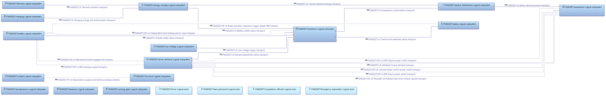
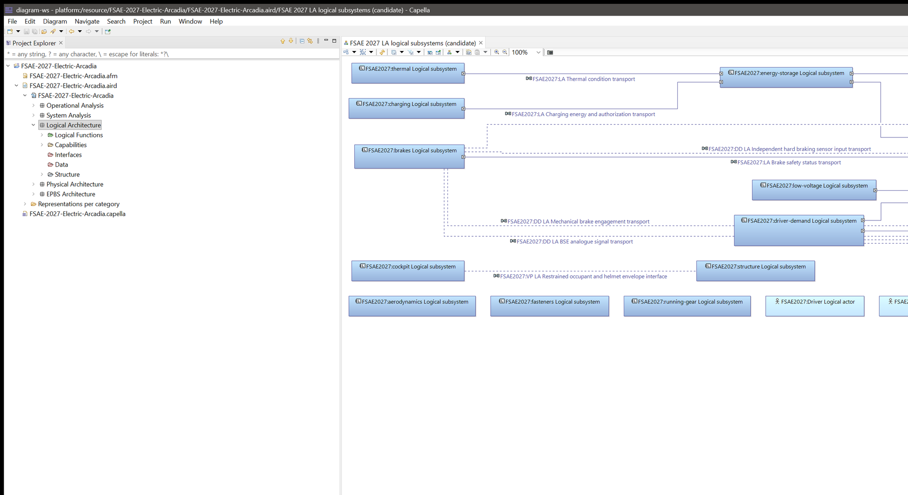
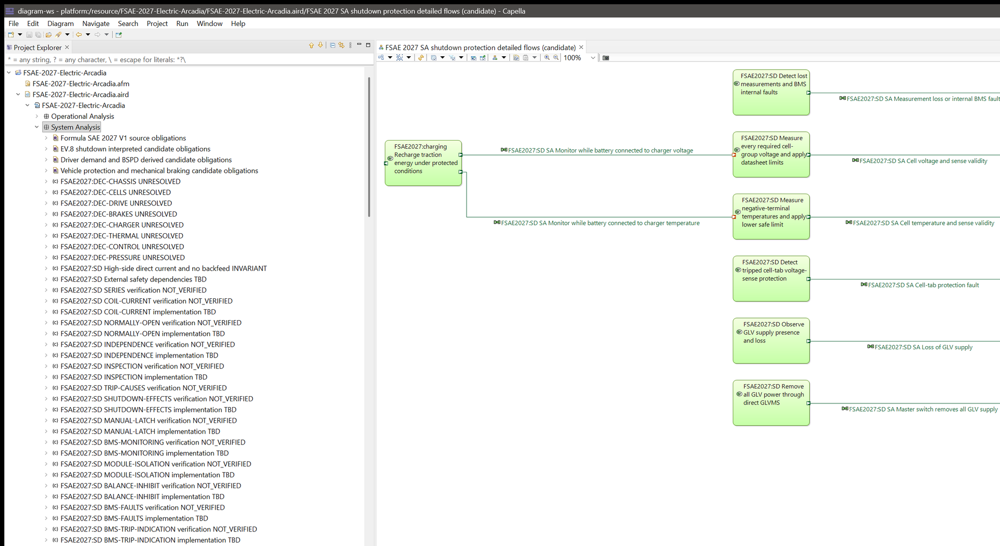
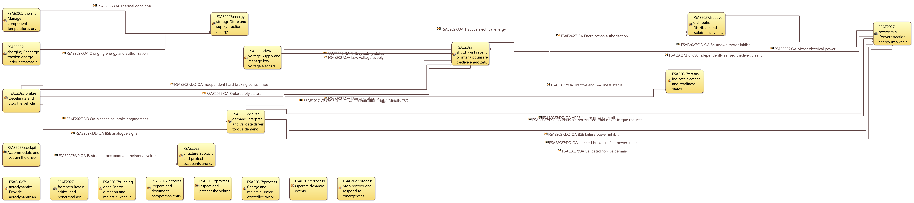
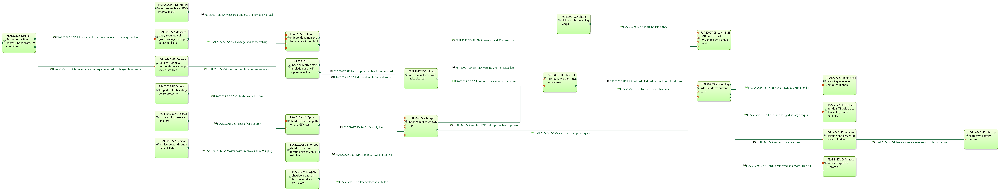
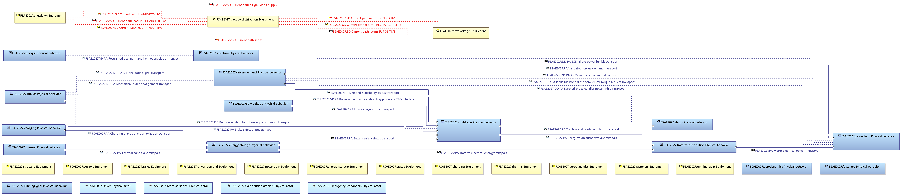
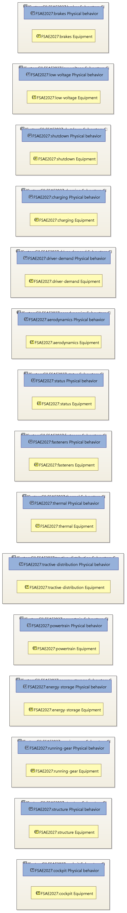

# FSAE 2027 Capella model

A Capella 7.0 reference model of a Formula SAE 2027 electric car: rules as requirements, a candidate
architecture across all five Arcadia perspectives, and the open decisions left to make.

Logical architecture: the candidate subsystems and their exchanges. Select the image for full size.

**[Getting started](docs/GETTING-STARTED.md)** ·
**[Model guide](docs/MODEL-GUIDE.md)** ·
**[Diagrams](docs/DIAGRAMS.md)** ·
**[Learn with AI](docs/LEARN-WITH-AI.md)** ·
**[Contributing](CONTRIBUTING.md)**

## What it is

A [Capella](https://eclipse.dev/capella/) 7.0 model of a Formula SAE 2027 electric car, built with the Arcadia
method (a way to describe a system in layers, from what its users need down to its parts) from the public 2027
rulebook, and the scripts that built it. It is the benchmark model of the
[Capella Agent Toolkit](https://github.com/sidkolapalli/capella-agent-toolkit) experiments.

It is meant as a reference platform and a head start. A Formula SAE team can use it as a guideline that mimics a
real vehicle development platform: rules turned into requirements, an architecture across all perspectives,
explicit open design decisions, and verification tracking. The same open decisions and TBD (to be decided) items
double as realistic tasks that show where AI agent skills fall short.

It is not a compliant or verified car:

- the architecture is a candidate;
- every source record has `verification_status=not_verified`;
- the eight design decisions (`DEC-*`) are open on purpose.

[`acceptance/README.md`](acceptance/README.md) says exactly what the model does and does not establish.

## At a glance

The terms in this table are explained in [docs/MODEL-GUIDE.md](docs/MODEL-GUIDE.md);
[Explore by layer](#explore-by-layer) below gives the plain-language version.

| | |
|---|---|
| Elements | 100,602 semantic elements across operational analysis, system analysis, logical, physical and end-product breakdown (EPBS) |
| Requirements | 3,871 in 5 modules: 3,197 source records from the Formula SAE Rules 2027 V1.0 (numbered paragraphs and unnumbered source objects), 86 candidate obligations and 588 competition-submission items in 80 folders |
| Functions | 72 operational activities; 93 system, 93 logical and 93 physical functions |
| Components | 5 operational entities; 5 system, 48 logical and 122 physical components and actors; 61 configuration items |
| Exchanges | 269 functional exchanges, 74 component exchanges, 19 physical links |
| Capabilities | 15 operational capabilities, 15 system capabilities, 30 capability realizations |
| Diagrams | 12, laid out and exported to [`docs/diagrams`](docs/diagrams) |
| Safety slices | 3: shutdown circuit (EV.8), driver demand and BSPD, vehicle protection and mechanical braking |
| Open decisions | 8: chassis, cells, drive, brakes, charger, thermal, control, pressure |
| Submissions | 7 checklists (SES, IAD, ESF, design documents, cost report, presentation, general rules) with readiness pages in [`docs/submissions`](docs/submissions) |

Each source requirement carries its rule identifier, page, heading and a hash of its text, but not the text itself.
The safety slices paraphrase their obligations and trace them to the architecture.

## Explore by layer

Arcadia looks at the same car from five angles, called layers. Below, each layer shows its complete diagram,
exported from the model: select a diagram to open it full size, where every label is readable. To open a diagram
in Capella yourself, expand **Representations per category** in the Project Explorer and double-click the diagram
name given under the picture.

Every element name starts with `FSAE2027:`. In Operational Analysis a topic tag follows, such as `brakes` or
`process`. The tag groups the activities by rulebook topic; it is not a chosen part.

### What you will see in Capella

The Project Explorer on the left holds the model tree, one folder per layer; the diagram editor is on the right.
Here the Logical Architecture is open:

And here System Analysis is expanded. Under it the Project Explorer lists the four requirement modules, the eight
open `DEC-*` design decisions and the tracking notes that follow them: `NOT_VERIFIED` means no evidence yet, `TBD`
a detail not chosen yet, and `INVARIANT` a property the design must always keep
([docs/MODEL-GUIDE.md](docs/MODEL-GUIDE.md#tracking-constraints) lists them all). The diagram is the shutdown
protection flows:

### 1. Operational Analysis: what people need to do

The yellow boxes are activities, such as "Inspect and present the vehicle" (a `process` activity: the team
presents the car at technical inspection) and "Decelerate and stop the vehicle", and the lines are what passes
between them. This layer answers: what must the driver, the team and the officials get done, before anyone
picks a design?

Diagram: `FSAE 2027 OA activities and interactions (candidate)`

### 2. System Analysis: what the car must do

Here the car is treated as a single whole, without its insides. The green boxes are the jobs it must do for
shutdown protection, such as "Measure every required cell-group voltage and apply datasheet limits". This layer
answers: what must the car do to meet the rules, and what is still undecided?

Diagram: `FSAE 2027 SA shutdown protection detailed flows (candidate)`

### 3. Logical Architecture: how the car splits into subsystems

The blue boxes are subsystems, such as energy storage, brakes, driver demand and cockpit, with no parts chosen
yet; the lines are what they pass to each other. This layer answers: which subsystem owns which job, and what must
each sub-team agree on with the others?

Diagram: `FSAE 2027 LA logical subsystems (candidate)`

### 4. Physical Architecture: what hardware does the job

The yellow boxes are equipment, such as the shutdown and tractive-distribution equipment, and the red dashed lines
are the shutdown current paths between them. The blue boxes are the behavior that runs on that equipment. This
layer answers: what hardware carries out each function, and how is it connected?

Diagram: `FSAE 2027 PA equipment and deployed behavior (candidate)`

### 5. EPBS: what you build or buy

EPBS stands for end-product breakdown structure. Each frame is a configuration item, such as the brakes or the
shutdown subsystem, holding its behavior and its equipment. This layer answers: which pieces will the team build,
buy and track as deliverables?

Diagram: `FSAE 2027 EPBS subsystem configuration items (candidate)`

### Requirements: the rules the car must meet

Requirements are not a layer: they live under System Analysis, in the four modules shown in the second Capella
picture above. Expand the EV.8 shutdown module to its paraphrased obligations, such as "Install the three required
shutdown buttons: left side, right side and cockpit." The model holds rule identifiers, page numbers and headings,
never the rule text, so keep the official rulebook open next to it.

All twelve diagrams, with what each shows, are in [docs/DIAGRAMS.md](docs/DIAGRAMS.md).

### Learn it faster: ask an AI agent

With the [Capella Agent Toolkit](https://github.com/sidkolapalli/capella-agent-toolkit), an AI agent such as
Claude Code, Codex, Cursor, GitHub Copilot or Gemini CLI can read the model open in Capella and answer questions
about it. It changes nothing unless you approve the exact edit in Capella. The agent can be wrong: check each answer
against the model. To find an element name it cites, type the name into the filter box at the top of the Project
Explorer. The toolkit repository is private for now. Once it is public, its
[install guide](https://github.com/sidkolapalli/capella-agent-toolkit/blob/main/docs/INSTALL.md) shows how to
connect each agent. [LEARN-WITH-AI.md](docs/LEARN-WITH-AI.md) has the setup steps and
questions to ask.

## Open the model

1. Install Capella 7.0 and
   [Requirements Viewpoint 0.14.0](https://github.com/eclipse-capella/capella-requirements-vp/releases/tag/v0.14.0)
   for Capella 7. The release page offers a dropins archive and an update site; the update site needs three
   dependency update sites added first, which the page lists.
2. Clone this repository, or download it from the
   [releases page](https://github.com/sidkolapalli/fsae-2027-capella-model/releases). The latest release suits
   exploring the model; see [Versions](#versions) to repeat the experiments.
3. Import [`model/FSAE-2027-Electric-Arcadia`](model/FSAE-2027-Electric-Arcadia) into your workspace as an
   existing project, with **File > Import...** and the existing-project import under **General**. Choose to copy
   the project into the workspace. Otherwise Capella saves your edits into the clone's model files, which CI
   checks and the benchmark harness reads.
4. In the Project Explorer, open `FSAE-2027-Electric-Arcadia.aird`. This loads the model and its 12 diagrams.

[docs/GETTING-STARTED.md](docs/GETTING-STARTED.md) gives the full steps. To change the model, see
[CONTRIBUTING.md](CONTRIBUTING.md).

## Versions

| Tag | What it holds | Use it for |
|---|---|---|
| [`v1.0.0`](https://github.com/sidkolapalli/fsae-2027-capella-model/tree/v1.0.0) | The project as `model/FSAE-2027-Electric-Arcadia.zip` (SHA-256 `66e693abfdf821af96f241ee707f74efe44939c4d7b3d63ef830169b075e1ba3`) | Every Capella Agent Toolkit experiment so far |
| [`v1.1.0`](https://github.com/sidkolapalli/fsae-2027-capella-model/tree/v1.1.0) | The same files as plain project files, byte-identical to the archive contents | Repeating the experiments without unzipping |
| `v1.2.0` | The same semantic model, with all 12 diagrams laid out | Reading and extending the model |

The semantic model is the same in all three: the `.capella` file's SHA-256 is
`2849ad9b229a025ea6b8958292971ee07d5ef8c3987202eb340e5f655fb00c2d`. In `v1.2.0` only the diagram layout changed,
so to repeat the experiments exactly, use `v1.1.0` or `v1.0.0`.

[`model/SHA256SUMS`](model/SHA256SUMS) records every model file, and CI checks it. A change to the model changes
the benchmark, so the release that ships it gets a new version tag.

## How it was built

The scripts in [`acceptance/`](acceptance) built the model in a disposable Capella project through the Capella
Agent Toolkit plug-in's dev server, in the order [`acceptance/README.md`](acceptance/README.md) gives.
[`acceptance/rules`](acceptance/rules) pins the rule inventory and [`acceptance/safety`](acceptance/safety) holds
the three slices, each with its own README. [`acceptance/submissions`](acceptance/submissions) adds the
competition-submission layer on top of them. The v1.2.0 diagram layout was applied afterwards and no script
reproduces it; [docs/DIAGRAMS.md](docs/DIAGRAMS.md#about-the-layout-and-the-images) explains.

## Using it as a benchmark

The task sets, harness and grader live in the toolkit's
[`test-models/evals`](https://github.com/sidkolapalli/capella-agent-toolkit/tree/develop/test-models/evals).

1. Clone this repository next to the toolkit and keep the folder name `fsae-2027-capella-model`. Or set
   `EVAL_MODEL` to its `model/FSAE-2027-Electric-Arcadia` folder.
2. To repeat the published experiments exactly, check out `v1.1.0` (`git checkout v1.1.0`). The default branch
   has the re-laid-out diagrams of `v1.2.0`.

## Licensing

| What | Licence |
|---|---|
| The model in `model/` and the JSON data in `acceptance/` | [CC BY 4.0](LICENSE-CC-BY-4.0) |
| The scripts in `acceptance/` (`.groovy`, `.py`) | [EPL-2.0](LICENSE) |

To attribute the model, cite "FSAE 2027 Capella model, https://github.com/sidkolapalli/fsae-2027-capella-model".

The rule identifiers, page numbers and headings come from the Formula SAE Rules 2027, which are copyright SAE
International. They are included only to trace each requirement to the rulebook and are not covered by the
licences above; the rule text itself is not included, and the safety obligations are paraphrased. Get the rulebook
from [fsaeonline.com](https://www.fsaeonline.com). This project is not affiliated with or endorsed by SAE
International; Formula SAE is a trademark of SAE International.
