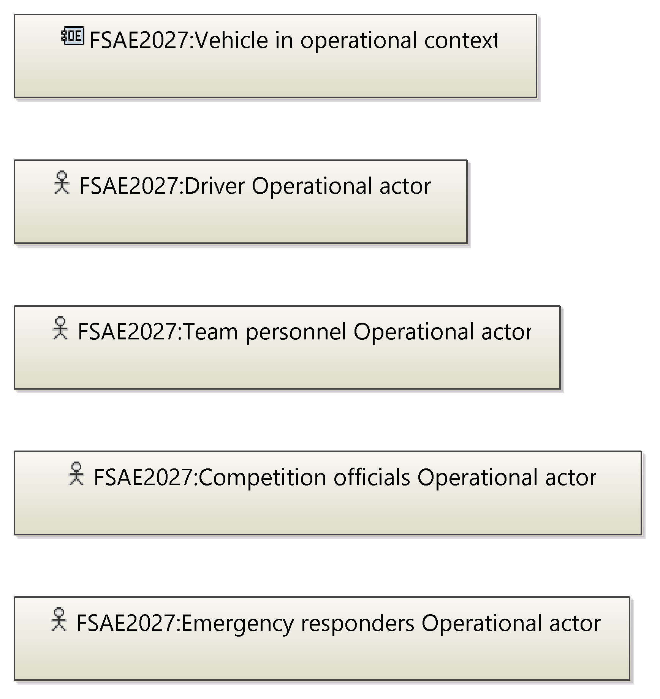
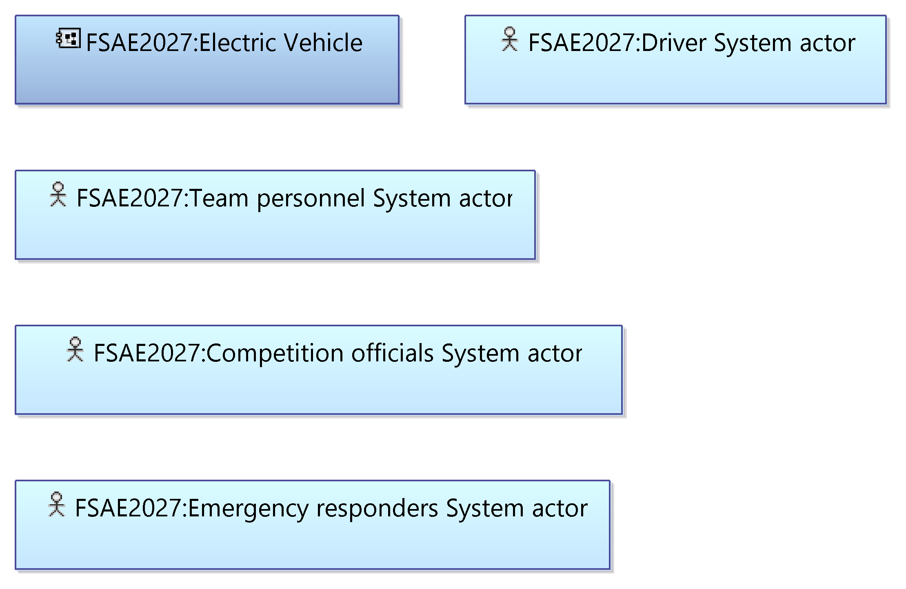
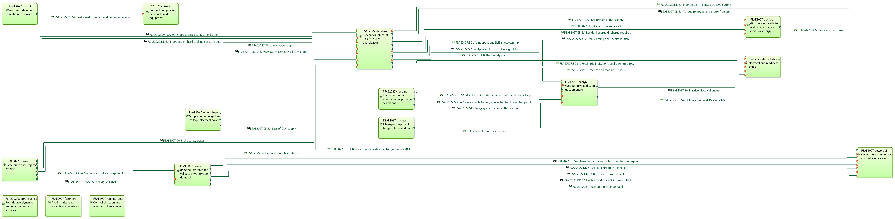
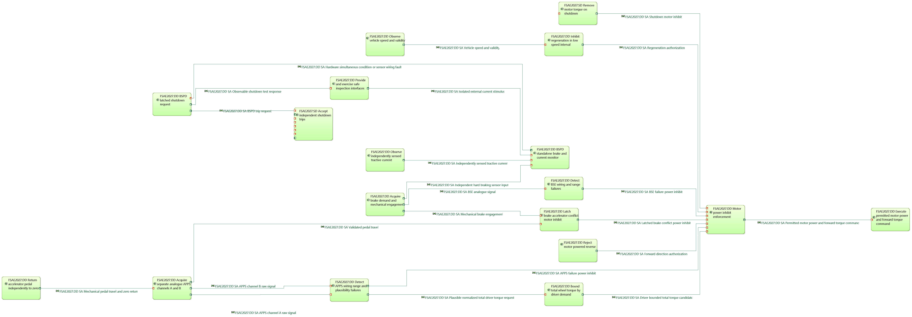
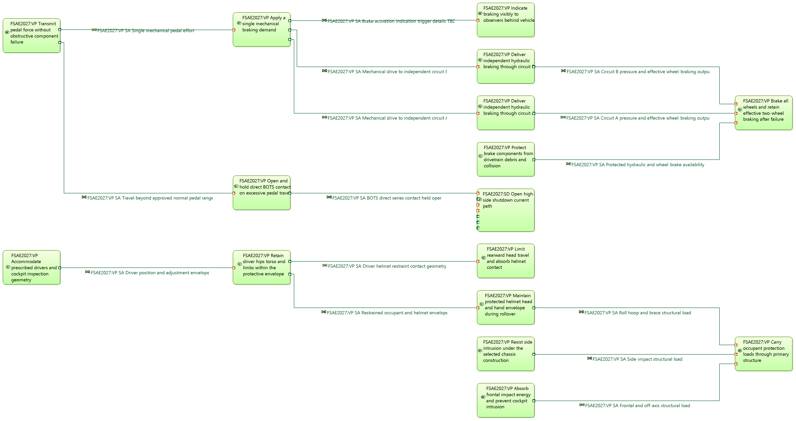

# Diagram gallery

The model has 12 diagrams. This page shows each one in Arcadia order: operational analysis (OA), system analysis
(SA), logical architecture (LA), physical architecture (PA) and end-product breakdown structure (EPBS).

Every diagram shows a candidate architecture. Every source requirement in the model has
`verification_status=not_verified`, and the eight `FSAE2027:DEC-*` design decisions are open on purpose. Read
the diagrams as a starting point to review and change, not as a verified or compliant car.
[`../acceptance/README.md`](../acceptance/README.md) says what the model does and does not establish.

## How to read this page

- **Name** is the diagram name exactly as it appears in Eclipse Capella®.
- **Type** is the Sirius diagram type.
- **Diagram elements** is the number of diagram elements the model reports for the view. The 12 views hold 435 in
  total. It is not a count of model elements. It counts the boxes and lines placed directly on the diagram, not
  boxes nested inside a container or ports. So diagram 12 reports 15, though 45 boxes are visible.
- Element names start with `FSAE2027:`. Exchange names carry the layer (`OA`, `SA`, `LA`, `PA`) and, for the
  three safety slices, a slice prefix: `SD` shutdown circuit, `DD` driver demand and BSPD, `VP` vehicle protection
  and mechanical braking. Each slice has a README in [`../acceptance/safety`](../acceptance/safety).
- The images are wide. GitHub shows them scaled to the page width. Click an image to open it at full size.

## About the layout and the images

The PNG files in [`diagrams/`](diagrams) show the layout introduced in v1.2.0.
Each diagram was laid out with the ELK-based auto-layout of the
[Agent Toolkit for Capella](https://github.com/sidkolapalli/agent-toolkit-for-capella) plug-in
(`api.diagram.layout(diagram, 'auto')`). The layout is not a stock Capella feature. Only the `.aird` file changed;
the semantic `.capella` file is byte-identical to v1.1.0.
[`../acceptance/34-layout-persisted-diagrams.groovy`](../acceptance/34-layout-persisted-diagrams.groovy) applied the
earlier layout of v1.0.0 and v1.1.0 with the `layered` and `grid` strategies. The v1.2.0 layout was applied
afterwards, and no acceptance script reproduces it.

To export a diagram yourself, first import the model as described in
[Open the model](../README.md#open-the-model). Then open the diagram, right-click an empty part of the diagram
background and choose **Export diagram as image**, then pick a file path and an image format. To export every
diagram at once, right-click the representations file (`.aird`) and choose **Export representations as images**,
then pick a folder and an image format. Both commands come from the Sirius 7.4 plug-ins bundled with Capella 7.0;
Sirius is the diagram framework Capella is built on. The
[Sirius diagram documentation](https://eclipse.dev/sirius/doc/user/diagrams/Diagrams.html) describes both, but it
names the second one **Export diagrams as image...**, an older label.

## Contents

| # | Perspective | Name | Type | Diagram elements |
|---|---|---|---|---|
| 1 | OA | [FSAE 2027 OA operational context (candidate)](#1-oa-operational-context) | Operational Entity Blank | 5 |
| 2 | OA | [FSAE 2027 OA activities and interactions (candidate)](#2-oa-activities-and-interactions) | Operational Activity Interaction Blank | 42 |
| 3 | SA | [FSAE 2027 SA vehicle and external actors (candidate)](#3-sa-vehicle-and-external-actors) | System Architecture Blank | 5 |
| 4 | SA | [FSAE 2027 SA vehicle functions and flows (candidate)](#4-sa-vehicle-functions-and-flows) | System Data Flow Blank | 49 |
| 5 | SA | [FSAE 2027 SA shutdown protection detailed flows (candidate)](#5-sa-shutdown-protection-detailed-flows) | System Data Flow Blank | 49 |
| 6 | SA | [FSAE 2027 SA driver demand and BSPD detailed flows (candidate)](#6-sa-driver-demand-and-bspd-detailed-flows) | System Data Flow Blank | 40 |
| 7 | SA | [FSAE 2027 SA occupant protection and braking detailed flows (candidate)](#7-sa-occupant-protection-and-braking-detailed-flows) | System Data Flow Blank | 31 |
| 8 | LA | [FSAE 2027 LA logical subsystems (candidate)](#8-la-logical-subsystems) | Logical Architecture Blank | 39 |
| 9 | LA | [FSAE 2027 LA logical functions and flows (candidate)](#9-la-logical-functions-and-flows) | Logical Data Flow Blank | 49 |
| 10 | PA | [FSAE 2027 PA equipment and deployed behavior (candidate)](#10-pa-equipment-and-deployed-behavior) | Physical Architecture Blank | 62 |
| 11 | PA | [FSAE 2027 PA physical functions and flows (candidate)](#11-pa-physical-functions-and-flows) | Physical Data Flow Blank | 49 |
| 12 | EPBS | [FSAE 2027 EPBS subsystem configuration items (candidate)](#12-epbs-subsystem-configuration-items) | EPBS Architecture Blank | 15 |

## Operational analysis

### 1. OA operational context

- **Name:** FSAE 2027 OA operational context (candidate)
- **Type:** Operational Entity Blank
- **Diagram elements:** 5

The view lists who and what takes part in operating the car: the entity `Vehicle in operational context` and four
operational actors (driver, team personnel, competition officials, emergency responders). No interactions are
drawn here; read it as the cast for diagram 2.

### 2. OA activities and interactions

- **Name:** FSAE 2027 OA activities and interactions (candidate)
- **Type:** Operational Activity Interaction Blank
- **Diagram elements:** 42

Each box is an operational activity, named after a vehicle domain (for example `energy-storage`, `shutdown`,
`brakes`, `driver-demand`, `powertrain`) or a team process (prepare competition entry, inspect and present the
vehicle, charge and maintain, operate dynamic events, stop and respond to emergencies). Arrows are interactions;
they run mostly left to right and end at the `powertrain` activity on the far right. The eight activities along the
bottom row have no interactions on this view yet.

## System analysis

### 3. SA vehicle and external actors

- **Name:** FSAE 2027 SA vehicle and external actors (candidate)
- **Type:** System Architecture Blank
- **Diagram elements:** 5

The view shows the system, `FSAE2027:Electric Vehicle`, and the same four roles as system actors. No exchanges are
drawn here. It fixes the system boundary that the SA function diagrams work inside.

### 4. SA vehicle functions and flows

- **Name:** FSAE 2027 SA vehicle functions and flows (candidate)
- **Type:** System Data Flow Blank
- **Diagram elements:** 49

Each box is a top-level system function for one vehicle domain, such as `shutdown` (prevent or interrupt unsafe
tractive energization) or `powertrain` (convert traction energy into vehicle motion). Lines are functional
exchanges; a label such as `FSAE2027:SD SA ...` tells you which safety slice added it. The `shutdown` function is the
hub most exchanges pass through. One exchange name ends in `TBD`, an open item left visible on purpose.

### 5. SA shutdown protection detailed flows

- **Name:** FSAE 2027 SA shutdown protection detailed flows (candidate)
- **Type:** System Data Flow Blank
- **Diagram elements:** 49

This is the shutdown slice (`SD`, EV.8) at leaf-function level. Read it left to right: monitoring and fault
functions (BMS, IMD, GLV supply, master and manual switches, interlock) feed `Accept independent shutdown trips`,
which feeds the latch held until local manual reset and then `Open high-side shutdown current path`. The functions on
the right are the safe outputs, such as removing relay coil drive, interrupting battery current and removing motor
torque.

### 6. SA driver demand and BSPD detailed flows

- **Name:** FSAE 2027 SA driver demand and BSPD detailed flows (candidate)
- **Type:** System Data Flow Blank
- **Diagram elements:** 40

This is the driver-demand slice (`DD`). Accelerator (APPS) and brake (BSE) signals pass through plausibility and
fault checks; the inhibit signals converge on `Motor power inhibit enforcement`, which feeds the function that
executes the permitted motor command on the far right. The standalone BSPD monitor feeds
`BSPD latched shutdown request`, which sends the BSPD trip request to the shutdown slice's `Accept independent shutdown trips`. The two `FSAE2027:SD` boxes are where this slice connects to
the shutdown slice.

### 7. SA occupant protection and braking detailed flows

- **Name:** FSAE 2027 SA occupant protection and braking detailed flows (candidate)
- **Type:** System Data Flow Blank
- **Diagram elements:** 31

This is the vehicle-protection slice (`VP`). The upper chain runs from pedal force to a single mechanical braking
demand, then through two independent hydraulic circuits (A and B) to wheel braking; a branch opens the BOTS contact in
the shutdown slice's `Open high-side shutdown current path`. The lower chain runs from driver accommodation and
restraint through head, rollover, side and frontal protection to `Carry occupant protection loads through primary
structure`.

## Logical architecture

### 8. LA logical subsystems

- **Name:** FSAE 2027 LA logical subsystems (candidate)
- **Type:** Logical Architecture Blank
- **Diagram elements:** 39

Each box is a logical subsystem, one per vehicle domain, plus the four logical actors along the bottom. Lines are
component exchanges, named `... transport` or `... interface`, that carry the functional exchanges between
subsystems. Subsystems with no lines here (aerodynamics, fasteners, running gear) and the unconnected actors show
where the architecture is still thin.

### 9. LA logical functions and flows

- **Name:** FSAE 2027 LA logical functions and flows (candidate)
- **Type:** Logical Data Flow Blank
- **Diagram elements:** 49

This view has the same shape as diagram 4 because the logical functions and exchanges realize the SA ones.
Exchange labels carry `LA` instead of `SA`. Compare the two side by side to follow a flow from the system level to
the logical level.

## Physical architecture

### 10. PA equipment and deployed behavior

- **Name:** FSAE 2027 PA equipment and deployed behavior (candidate)
- **Type:** Physical Architecture Blank
- **Diagram elements:** 62

Blue boxes are behavior components (`... Physical behavior`), yellow boxes are equipment (`... Equipment`), and
light-blue boxes are the physical actors; they are drawn side by side, not nested. Blue lines are component
exchanges between behavior components. The red dashed lines at the top join the shutdown, tractive-distribution and
low-voltage equipment; their names start with `FSAE2027:SD Current path`. The other 12 equipment boxes, along the
bottom with the aerodynamics, fasteners and running-gear behavior components and the four actors, have no links
yet.

### 11. PA physical functions and flows

- **Name:** FSAE 2027 PA physical functions and flows (candidate)
- **Type:** Physical Data Flow Blank
- **Diagram elements:** 49

This view mirrors diagrams 4 and 9 at the physical level, with `PA` in the exchange labels. Together the three show
the same functional flow realized from system to logical to physical.

## End-product breakdown structure

### 12. EPBS subsystem configuration items

- **Name:** FSAE 2027 EPBS subsystem configuration items (candidate)
- **Type:** EPBS Architecture Blank
- **Diagram elements:** 15

Each container is one subsystem configuration item, named `FSAE2027:<domain> Subsystem CI`, holding the behavior
component and the equipment it realizes from the physical architecture. Read it top to bottom as the list of items a
team would build or buy. The model has more configuration items than this view shows, including the safety slices'
hardware items.

